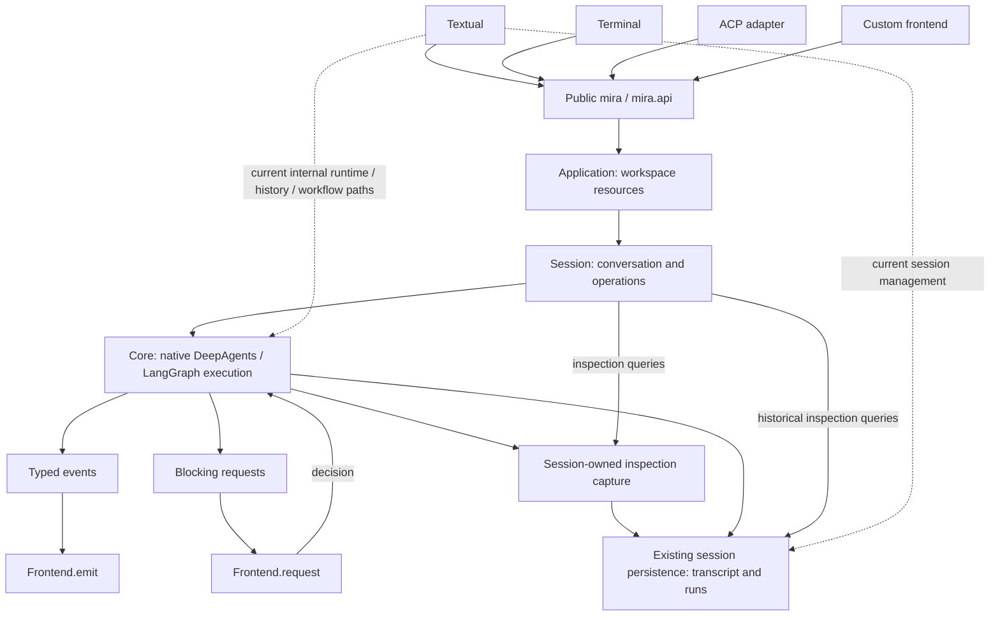
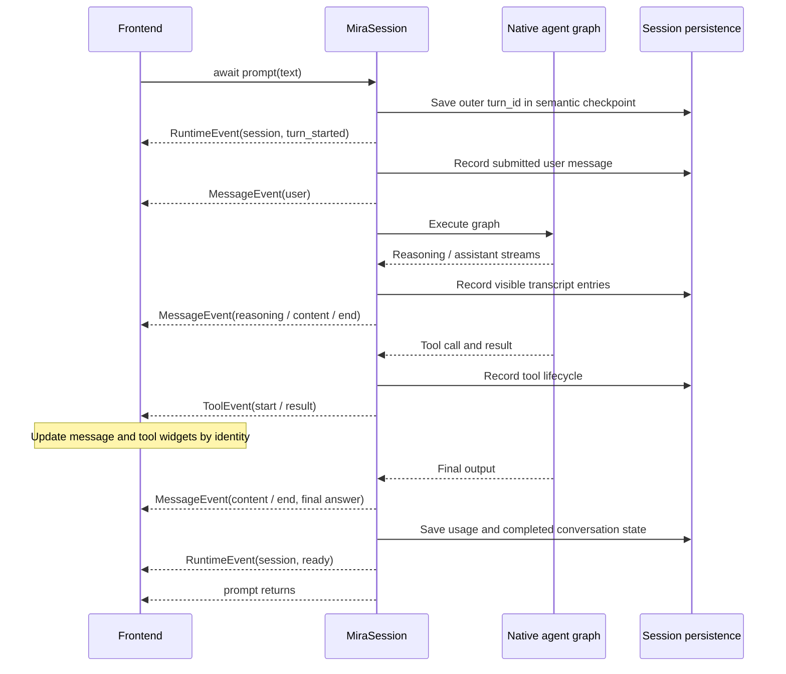
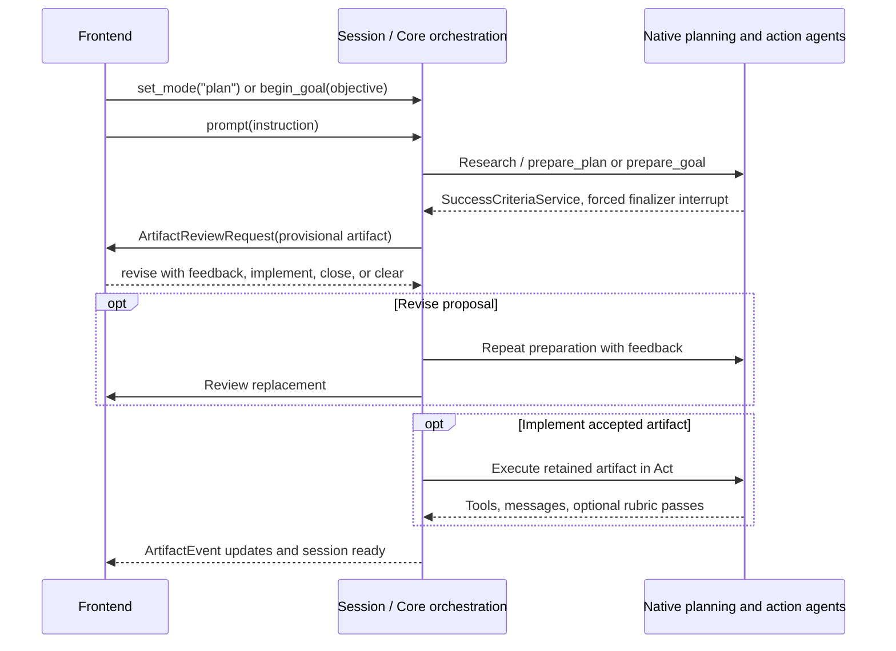

# How MIRA frontends work

A frontend draws the conversation and collects user choices. MIRA owns the
agents, graph execution, saved conversation, and inspection capture. The same
boundary works for a terminal, a future PySide6 window, or an embedded service.

There are three directions of communication:

| Mechanism | Direction | Example |
| --- | --- | --- |
| API operation | Frontend → MIRA | `await session.prompt("Inspect this project")` |
| Event | MIRA → frontend | `MessageEvent(phase="content", text="Found…")` |
| Blocking request | MIRA → frontend → MIRA | `ApprovalRequest` followed by the user's decisions |

`MiraApplication` starts workspace resources and closes them at shutdown.
`MiraSession` represents one durable conversation and controls its operations.
`Frontend` is the two-method protocol implemented by the host: synchronous
`emit(FrontendEvent)` and asynchronous `request(FrontendRequest)`.
`SessionSnapshot` is a detached view for opening or refreshing a conversation;
events update the display between snapshots. Requests suspend execution until
the frontend answers. They are not notifications.

Start with the complete [minimal frontend](frontend-api.md#build-a-minimal-frontend).
Then use the walkthroughs below to understand the runtime; the
[API reference](frontend-api.md#operation-reference) gives exact contracts.

## Current boundary



The solid public boundary is implemented for normal prompts, decisions,
artifacts, snapshots, and inspection. Dashed paths are remaining exceptions,
not capabilities a custom frontend must reproduce. The intended final boundary
would remove those dashed dependencies. It has not yet been implemented.
ACP also owns protocol transport and request serialization; that is consumer work.

## One ordinary prompt

Suppose the user asks, “Read the project notes and explain the setup.”



The displayed answer streams before `prompt()` returns. A model can speak,
call a tool, and speak again within that one call. `MessageEvent(phase="end")`
ends a model stream, not the user's interaction. Persistence is incremental;
the sequence groups writes to explain ownership rather than promising one
write per diagram arrow. Consumers should use events during streaming and a
snapshot at operation boundaries.

## Approval and native HITL

```mermaid
sequenceDiagram
    participant G as Native graph
    participant C as Core runner
    participant F as Frontend
    participant U as User
    G-->>C: Tool action requires approval; checkpoint interrupt
    C->>F: await request(ApprovalRequest)
    F->>U: Display action and arguments
    U-->>F: Allow, reject, or edit
    F-->>C: Ordered decision dictionaries
    C->>G: Command(resume= native decision mapping)
    G-->>C: Continue tool / model streams
    C-->>F: ToolEvent and MessageEvent updates
```

The frontend returns decisions; it neither executes the proposed tool nor
resumes LangGraph itself. Core partitions multiple interrupts by their native
IDs. An unsupported request should raise rather than fabricate an approval.
See [exact responses](frontend-api.md#blocking-requests-and-exact-responses),
including AskUser, artifact review, MCP connection approval, and MCP elicitation.

## Delegation and the Inspector

```mermaid
sequenceDiagram
    participant G as Native graph / child
    participant C as Core capture and durable projection
    participant F as Frontend
    participant S as MiraSession
    G-->>C: Parent task/eval tool and child identity
    C-->>F: SubagentEvent(start / eval_start, metadata.inspection_id)
    G-->>C: Child reasoning, messages, tools
    C->>C: Update session store; project existing runs[]
    C-->>F: RuntimeEvent(inspection, append / delta / reset / status)
    F->>S: inspection(inspection_id)
    S-->>F: Detached LiveInspection
    Note over F: Replay initial payload, then apply incremental updates
    G-->>C: Child finishes or is cancelled
    C-->>F: Terminal lifecycle / inspection notifications
    Note over F,S: After reopening a saved session
    F->>S: inspections(origin_event_id=parent_event_id)
    S-->>F: Detached run summaries
    F->>S: inspection(selected_run_id)
    S-->>F: Detached historical transcript or None
```

The parent `task` call owns a standalone child; an `eval` call can own several
parallel child rows. Native parent-call, row, and namespace identities separate
siblings even when their descriptions are identical. `inspection_id` identifies
the child transcript, while the durable run's `id` identifies its saved record.
`origin_event_id` links that record to an existing parent tool entry when one
is available. A standalone task can be represented only by a delegation event,
so its run can have no durable parent tool entry; retain the native call ID
without inventing one. Streams
may arrive before their parent call, so Core can backfill this relationship.
Do not correlate children by display names or matching task text.

Rubric verifier and grader transcripts have distinct IDs such as
`rubric:run-1:0:verifier` and `rubric:run-1:0:grader`. Workflow agent inspections
use the same capture and durable run structures but have no parent task/eval
tool entry. Workflow node input/result and final-state views are presentation
of existing workflow events and retained history, not child transcripts.

Capture continues when the Inspector is closed. Full contents are fetched on
selection, not included in session snapshots or every notification. A frontend
may ignore inspection notifications entirely without disabling capture.

## Formal Plans and Goals

Formal artifacts are reviewed objects, not assistant prose. PLAN is a
persistent read-only conversation; a Goal is an explicit objective with success
criteria and no hidden implementation plan. Both use mandatory success-criteria
generation and finalizer review regardless of whether runtime rubric grading
is enabled.



Preparation, revision, and immediate implementation can all belong to the same
outer `turn_id`. A later explicit attempt starts a new operation. To implement
retained work, `await session.start_artifact(kind)`, then submit the execution
instruction with `prompt()`. To revise retained work, use
`begin_artifact_revision(kind, artifact, feedback)` before prompting. Read the
retained artifact from `snapshot().current_plan` or `.current_goal`.
`clear_artifact()` removes it. Closing presentation controls retains it.
Only one formal artifact is current; consumers should confirm replacement of
incomplete work before staging another. Core commits a replacement only after
successful presentation. Proposal review and retained-artifact operations have
different semantics; see the reference.

## Cancellation, opening, and recovery

```mermaid
sequenceDiagram
    participant F as Frontend
    participant S as Session
    F->>S: prompt(text) in a task
    S-->>F: RuntimeEvent(session, turn_started)
    F->>S: await cancel()
    S-->>F: RuntimeEvent(session, cancelling)
    S->>S: Cancel native execution; finalize observed tools and inspections
    S-->>F: RuntimeEvent(session, ready)
    S-->>F: Prompt task raises CancelledError
    F->>S: open_session(session_id, resume=True)
    S-->>F: Session opened; no agent execution
    F->>S: snapshot() and inspection(selected_id)
    opt Saved approval exists
        F->>S: await resume_pending()
        S->>F: Redisplay blocking request
        F-->>S: User decision
        S->>S: Resume saved graph with retained turn_id
    end
    opt Incomplete graph without saved approval
        F->>S: await continue_incomplete() after explicit user choice
        S->>S: Continue graph; external side effects may repeat
    end
```

`cancel()` requests cancellation; await the prompt task to finish cleanup.
Opening an existing session is for display and recovery discovery, not an
instruction to resume it. `resume_pending()` answers an existing checkpointed
request; `continue_incomplete()` explicitly retries uncertain work. Neither
adds a second user message. Their no-work case returns `None`.

Recovery discovery is still an internal descriptor in official consumers; a
public pending-state snapshot is deferred. Custom frontends can offer explicit
resume and continue actions using the supported methods, but cannot infer that
descriptor from `runtime_state="ready"`. Inspection queries work without
resuming execution. Session close releases its live transcripts; saved runs
remain available after reopening. Late notifications for another session must
not update the currently displayed Inspector.

## Identity through the transcript

Consider one prompt with ID `turn-A`:

```text
session-1 / turn-A
  user entry 10
  model message m1 → reasoning entry 11, assistant entry 12
  eval call tc1 → tool-call entry 13
    child row child-a → inspection subagent:child-a → durable run r1
    run r1.origin_event_id = 13
  eval result tc1 → entry 14, origin_event_id = 13
  model message m2 → assistant entry 15
```

| Identity | Meaning and how to use it |
| --- | --- |
| `session_id` | Durable conversation; route observations to the correct view. |
| `turn_id` | Opaque outer interaction, saved before execution and retained on explicit recovery. A failed new prompt still gets a distinct ID. |
| `message_id` | Native model message; separate model invocations can share one turn. |
| `event_id` | Existing persisted display entry within this session. Deltas can update the same entry. Zero means no durable entry yet. |
| `origin_event_id` | Existing parent tool entry for updates/results; saved inspection runs also retain this relationship. |
| `tool_call_id` | Native call identity. Use it for streamed arguments, start, stop, and authoritative completion of the same tool. |
| `namespace`, `metadata` | Native execution path and provenance. Keep them when diagnosing or separating parallel execution. |
| `inspection_id` | Live/historical transcript key supplied by lifecycle events. Durable run IDs are also accepted by `inspection()`. |

Do not create a widget for every delta. Update a model stream or tool row using
the identities it already carries. A recovered tool start can refer to an
existing historical widget, and its eventual result can replace a stopped
outcome. Transient drafts acquire durable references when promoted. Historical
entries without provenance remain unassigned; display their saved order without
inventing precise turn or native-message relationships.

## Ownership reference

| Responsibility | Owner |
| --- | --- |
| Agent execution and native HITL resume | Core runner and native graph |
| Session lifecycle, cancellation, recovery | `MiraSession`; frontend chooses when to invoke operations |
| Event identities and persistence | Core recorders, semantic checkpoints, existing session storage |
| Inspection capture and live state | Session-owned store; Core child/rubric/workflow observers |
| Historical inspection access | Public session queries over existing durable runs |
| Runtime configuration | Application and configuration modules; official Textual rebuild controls still use internals |
| Rendering and presentation state | Frontend: widgets, selection, expansion, tab placement |
| Focus and scrolling | Frontend |
| User interaction | Frontend collects choices; Core validates/routes decisions |
| Registered workflow launch and history | Still internal execution and persistence wiring in Textual |

The live inspection store is an execution observation, not another persistence
layer. Durable `runs[]` are its historical projection and retain terminal state
after process exit. Coordinator maps are transient native-stream correlation;
they are not a second transcript. Frontends never receive the mutable store.

## The actual Textual integration

The official frontend is an incremental migration. These are implementation
pointers, not prerequisites for writing another frontend:

| Step | Current entry points |
| --- | --- |
| Startup / session opening | [CLI bootstrap](../cli/commands.py), `MiraApp._startup`, `_activate_core_session` in [app.py](../ui/textual/app.py) |
| Prompt submission | `MiraApp._run_turn` → `core_session.prompt()` |
| Typed events | [TextualFrontend.emit](../ui/textual/adapter.py) |
| Existing callback projection | [RendererAdapter](../ui/shared/adapter.py) → application callbacks → [ChatLog](../ui/textual/widgets/chat_log.py) |
| Blocking requests | `TextualFrontend.request` → `foreground_interrupt` → existing serialized editors / approval controls |
| Inspector selection | App selection handlers → `core_session.inspection()` / `.inspections()` → [Inspector](../ui/textual/widgets/inspector.py) |
| Restoration | `_activate_core_session`, `_render_current_session`; transcript restoration still uses internal record format |
| Cancellation / cleanup | `action_interrupt_or_quit`, `_confirm_interrupt_or_quit`, session cancellation, application shutdown; Inspector close only ends presentation |

| Event | Presentation |
| --- | --- |
| `MessageEvent` | Assistant/reasoning streams and existing message widgets |
| `ToolEvent` | Tool bubble, streamed arguments, approval and timing state |
| `SubagentEvent` | Subagents panel and task rows |
| `RubricEvent` | Separate verifier/grader evaluation bubbles |
| `ArtifactEvent` and artifact requests | Existing Plan and Goal bubbles and controls |
| `WorkflowEvent` | Workflow tree, node summaries, final-state view |
| Session/waiting `RuntimeEvent` | Runtime status and waiting indicators |
| Inspection `RuntimeEvent` | Direct incremental Inspector update; no callback/provenance double delivery |

Other typed events still pass through the shared renderer adapter and then
Textual retains their provenance on widgets. This transitional path is retained
for terminal and workflow consumers. Inspection notifications consume the typed
event directly in that same channel. External frontends implement only `emit`
and `request`; reproducing Textual's callbacks is unnecessary.

## Migration inventory

| State | Boundary |
| --- | --- |
| Supported | Application start/shutdown, session operations, typed events, requests, detached snapshots, formal artifact operations |
| Completed in Phase 2A | Outer identity, durable event/origin references, error/recovery routing, explicit production Textual adapter |
| Completed in Phase 2B | Session-owned capture, public inspection retrieval, typed incremental notifications, Inspector queries; removed hidden renderer traversal and UI transcript capture |
| Remaining | Textual runtime reconstruction/settings, direct transcript restoration and session management, registered workflow launch/history orchestration; transcript clearing calls a private session inspection-cleanup hook until that broader lifecycle migrates |
| Workflow exception | Textual still launches the internal `execute_workflow` and owns workflow history wiring. Core now constructs and closes inspection capture/projection with the session; Inspector retrieval is public. There is no public workflow session operation yet. |
| Deferred | Runtime reconstruction migration, broader session-management API, workflow execution API, grouped-turn transcript redesign, public recovery descriptor |

See [architecture decisions](../ARCHITECTURE_DECISIONS.md#headless-application-and-public-api)
for rationale and the [API guide](frontend-api.md) for integration contracts.
