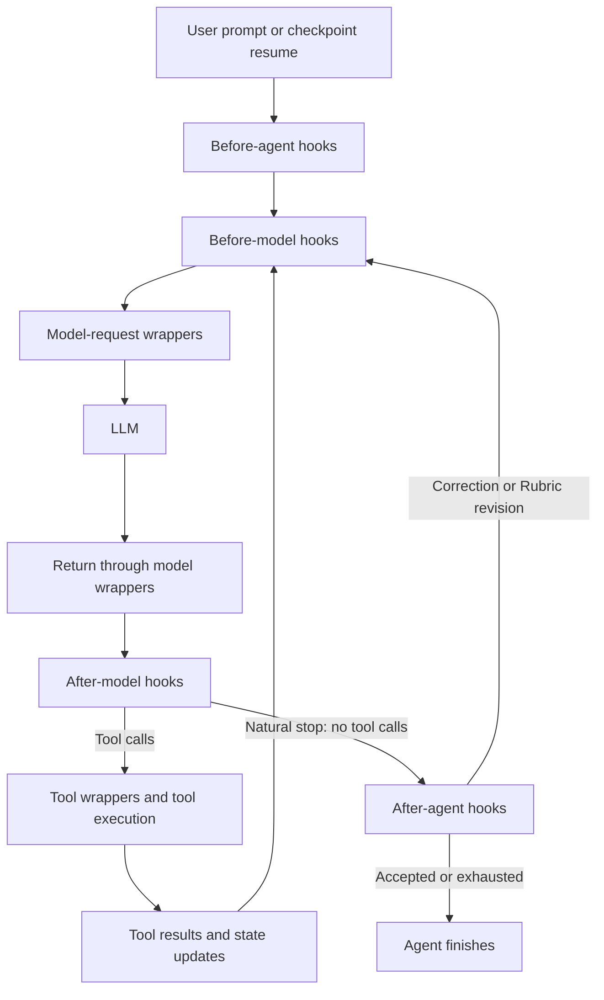

# MIRA middleware guide

Middleware is code around an agent's normal model-and-tool loop. Each piece has
a specific job: for example, hide unavailable tools, remind the model that the
user switched modes, or shorten an oversized conversation before calling the
model. Some pieces only observe; others change requests, return tool errors,
update graph state, or ask the graph to take another step.

This guide describes MIRA's middleware, rechecked for the dependency upgrade
from `4b5f01b` against **DeepAgents 0.7.38, LangChain 1.5.0, LangGraph 1.2.21, and
langchain-quickjs 0.3.12**. Dependency upgrades can change the automatically
inserted stack. Settings below are fresh-workspace defaults, not a claim about
an existing user's configuration.

## Contents

- [Execution flow and ordering](#execution-flow-and-ordering)
- [MIRA inventory](#mira-inventory)
- [Upstream inventory](upstream.md#inventory)
- [Effective main-agent stacks](#effective-main-agent-stacks)
- [Subagents and other construction paths](#subagents-and-other-construction-paths)
- [Interactions](#interactions)
- [Questions for future review](#questions-for-future-review)
- [Audit and maintenance](#audit-and-maintenance)
- [Detailed MIRA reference](mira.md)
- [Detailed upstream reference](upstream.md)

## Execution flow and ordering



A **hook** is a callback at one of these boundaries. A **wrapper** receives a
request and a handler for the rest of the chain; it can call that handler,
change the request first, process its result, retry it, or decline to call it.
The diagram shows the normal route. Hooks can also interrupt or redirect it;
an end redirect still enters after-agent hooks.

LangChain uses registration order for `before_agent` and `before_model`, and
reverse registration order for `after_model` and `after_agent`. For wrappers,
the first registered wrapper is outermost: `[A, B]` means
`A -> B -> model/tool -> B -> A`. Only middleware implementing that hook
participates. Tool wrappers apply to each dispatched tool call, not once per
whole batch; tools in a batch can execute concurrently.

Synchronous invocation uses `before_model`, `wrap_model_call`, etc.; async
invocation uses `abefore_model`, `awrap_model_call`, etc. These are alternative
implementations of the same boundary, not two successive passes. MIRA normally
streams asynchronously. Most local middleware supplies both variants;
`_ParentNotifierMiddleware` deliberately reports only on its async path.

**Graph state** is the checkpointable data carried between nodes, including
`messages` and middleware-specific channels. Hook return dictionaries,
tool `Command` updates, and `ExtendedModelResponse.command` can update it.
Fields marked private are hidden from public input/output schemas; they can
still be checkpointed. A `request.override(...)` changes that model call only.
It does not by itself append to the conversation or save a system prompt.
Runtime context and context variables carry process-local capabilities or
observations; they are different from graph channels and session JSON.

## MIRA inventory

`M` = model wrapper, `T` = tool wrapper, `BA/BM/AM/AA` = before-agent,
before-model, after-model, after-agent. Hook names include their async variants.
`Fork` means inherited through native DeepAgents fork construction, not copied
to every isolated worker. See the construction paths below for exceptions.

There are **17 locally defined middleware classes**: **14 MIRA-owned** classes
(including the locally maintained repeated-call adaptation) and **3 upstream
subclasses**. MIRA also customizes **1 upstream summarization instance** without
declaring a subclass. Thus this table has **18 entries**, not 18 locally defined
classes. Counts are types/implementations, not simultaneous instances.

| Middleware | Purpose | Plan | Act | Subagents | Hook(s) | Source file |
| --- | --- | --- | --- | --- | --- | --- |
| [RepeatedToolCallMiddleware](mira.md#repeatedtoolcallmiddleware) | Bound consecutive identical tool requests | Optional | Optional | Owned raw specs; forks | BM, T | [repeated_tool_call_guard.py](../../agent/middleware/repeated_tool_call_guard.py) |
| [FileReferenceMiddleware](mira.md#filereferencemiddleware) | Explain how to read explicit file/resource mentions | Yes | Yes | Fork | M | [file_references.py](../../agent/middleware/file_references.py) |
| [ModelCompatibilityMiddleware](mira.md#modelcompatibilitymiddleware) | Normalize image representations, response metadata and file arguments | Yes | Yes | Owned raw specs; forks | M | [model_compatibility.py](../../agent/middleware/model_compatibility.py) |
| [ProviderContextOverflowMiddleware](mira.md#providercontextoverflowmiddleware) | Translate context-limit failures for native recovery | Yes | Yes | Fork | M | [context_overflow.py](../../agent/middleware/context_overflow.py) |
| [ExecuteToolDescriptionRewriteMiddleware](mira.md#executetooldescriptionrewritemiddleware) | Explain host-shell versus virtual paths | Yes; usually no visible execute | Yes | Fork | M | [execute_tool_description_rewrite.py](../../agent/middleware/execute_tool_description_rewrite.py) |
| [ExecutionContextMiddleware](mira.md#executioncontextmiddleware) | Bind the current ToolRuntime for nested Python calls | Yes | Yes | Owned raw specs; forks | T | [context.py](../../agent/execution/context.py) |
| [PlanningStageEnforcementMiddleware](mira.md#planningstageenforcementmiddleware) | Separate research from forced formal finalization | Yes | No | Plan fork inherits | M, T | [planning_stage_enforcement.py](../../agent/middleware/planning_stage_enforcement.py) |
| [CorrectionMiddleware](mira.md#correctionmiddleware) | Repair invalid natural stops during Plan/Goal research | Yes | No | Plan fork inherits | BA, M, AM, AA | [correction.py](../../agent/middleware/correction.py) |
| [ProjectToolErrorMiddleware](mira.md#projecttoolerrormiddleware) | Return ordinary workspace-tool failures to the model | If project tools loaded | If project tools loaded | Owned raw specs; forks | T | [project_tool_errors.py](../../agent/middleware/project_tool_errors.py) |
| [ModelToolVisibilityMiddleware](mira.md#modeltoolvisibilitymiddleware) | Hide and reject unavailable tool names | Yes | Yes | Explicit allowlists; forks | M, T | [model_tool_visibility.py](../../agent/middleware/model_tool_visibility.py) |
| [ModeTransitionMiddleware](mira.md#modetransitionmiddleware) | Add temporary guidance for the current mode-change turn | Yes | Yes | Fork; needs matching context/anchor | M | [mode_transition.py](../../agent/middleware/mode_transition.py) |
| [ContextReportMiddleware](mira.md#contextreportmiddleware) | Record request inputs and native token estimates | Yes | Yes | Fork | M | [context_report.py](../../agent/middleware/context_report.py) |
| [_VerifierToolObserver](mira.md#_verifiertoolobserver) | Publish real verification tool events | No | Via Rubric only | Verifier only | T | [middleware.py](../../agent/rubric/middleware.py) |
| [VerifierReadCoverageGuard](mira.md#verifierreadcoverageguard) | Require all offloaded evidence lines to be retrieved | No | Via Rubric only | Offloaded verifier only | BA, M, AM, AA | [offload.py](../../agent/rubric/offload.py) |
| [InspectableCodeInterpreterMiddleware](mira.md#inspectablecodeinterpretermiddleware) — subclass | Keep QuickJS Eval child streams and interrupt replay inspectable | Yes | Yes | Fork | Inherited BA, M, AA; wraps Eval implementation | [code_interpreter.py](../../agent/middleware/code_interpreter.py) |
| [MiraCompactionMiddleware](mira.md#miracompactionmiddleware) — subclass | Provide compact tool and explicit forced-compaction planner | Yes | Yes | Fork | Inherited M; contributes tool | [compaction.py](../../agent/middleware/compaction.py) |
| [MiraRubricMiddleware](mira.md#mirarubricmiddleware) — subclass | Verify evidence, grade, and request bounded revisions | No | Optional | Act fork inherits; nested verifier/grader | Inherited BA, AA | [middleware.py](../../agent/rubric/middleware.py) |
| [SummarizationMiddleware](mira.md#summarizationmiddleware-customized-instance) — customized instance | Native automatic compaction with safe archives/replay | Yes | Yes | Independent native instances; forks can inherit replacement | M | [compaction.py](../../agent/middleware/compaction.py) |

The scope breakdown is **13 shared + 2 Plan-only + 1
Act-only + 2 verifier-only = 18**. Fork inheritance is a construction property,
not a promise that every inherited hook becomes active in that child.

Optional settings live in [config/settings.py](../../config/settings.py):

| Setting below `.mira/settings.yml` | Default | Effect |
| --- | --- | --- |
| `system.repeated_tool_call_guard.enabled` | `false` | Add guard to main agents and owned raw subagent specs |
| `system.repeated_tool_call_guard.max_repeats` / `max_blocked_attempts` | `3` / `2` | Executed repeats, then recoverable blocks; each setting accepts 1–100 |
| `system.planning_todos.enabled` | `false` | Add native TodoListMiddleware to both main modes and MIRA-compiled children |
| `system.planning_response_status.max_retries` | `2` | Plan/Goal natural-stop retries; accepts 1–20 |
| `system.rubric.enabled` / `max_iterations` | `false` / `3` | Build Act Rubric middleware; grading requires invocation state `rubric`; cap accepts 1–20 |
| `system.dynamic_subagents.enabled` / `response_schema` | `false` / `true` | Enable QuickJS delegation when both Eval and task are enabled; disabling response schemas selects MIRA precompilation for isolated raw specs |
| `models.summarization` / `models.rubric` | `null` / `null` | Optional model assignments; otherwise use Main |
| `hitl.tools.<name>` and MCP tool policies | Per tool | Enablement, approval, Plan access, PTC access, Rubric access |

PTC means **programmatic tool calling**: calling a tool from JavaScript inside
Eval. Dynamic subagents are optional Eval/task behavior; ordinary task
delegation does not depend on that switch. CLI rubric options can enable
grading in memory for one run; they do not change the saved defaults.

## Effective main-agent stacks

Construction is in [factory.py](../../agent/factory.py) and
[builder.py](../../agent/middleware/builder.py). The following is registration
order, hence model-wrapper entry order, for the ordinary harness profile.
`D` is inserted by DeepAgents, `M` is supplied by MIRA. Omit bracketed entries
when their condition is false.

| Order | Plan | Act | Owner / condition |
| --- | --- | --- | --- |
| 1 | FilesystemMiddleware | Same | D |
| 2 | SubAgentMiddleware | Same | D; synchronous children available |
| 3 | _ParentNotifierMiddleware | Same | D |
| 4 | SummarizationMiddleware | Same | D slot, replaced in place by MIRA's prepared instance |
| 5 | PatchToolCallsMiddleware | Same | D |
| 6 | [AsyncSubAgentMiddleware] | Same | D; remote `graph_id` specs available |
| 7 | [RepeatedToolCallMiddleware] | Same | M; guard enabled |
| 8 | [TodoListMiddleware] | Same | M; todos enabled |
| 9 | FileReferenceMiddleware | Same | M |
| 10 | ModelCompatibilityMiddleware | Same | M |
| 11 | ProviderContextOverflowMiddleware | Same | M |
| 12 | InspectableCodeInterpreterMiddleware | Same | M |
| 13 | MiraCompactionMiddleware | Same | M |
| 14 | ExecuteToolDescriptionRewriteMiddleware | Same | M |
| 15 | ExecutionContextMiddleware | Same | M |
| 16 | PlanningStageEnforcementMiddleware | — | M |
| 17 | CorrectionMiddleware | — | M |
| 18 | — | [MiraRubricMiddleware] | M; Rubric enabled |
| 19 | [ProjectToolErrorMiddleware] | Same | M; active project-owned tool names exist |
| 20 | ModelToolVisibilityMiddleware | Same | M |
| 21 | ModeTransitionMiddleware | Same | M |
| 22 | ContextReportMiddleware | Same | M |
| 23 | [Harness-profile extra middleware] | Same | D; profile-dependent insertion |
| 24 | [SkillsMiddleware] | Same | D; skills argument is not `None`, including an empty list |
| 25 | AnthropicPromptCachingMiddleware | Same | D; lazy wrapper, no-op for other model types |
| 26 | [BedrockPromptCachingMiddleware, FireworksPromptCachingMiddleware] | Same | D; corresponding optional packages installed |
| 27 | [MemoryMiddleware] | Same | D; memory argument is not `None` |
| 28 | [HumanInTheLoopMiddleware] | Same | D; merged interrupt policy is not `None` |
| 29 | UnsupportedContentMiddleware | Same | D |
| 30 | ModelRefusalMiddleware | Same | D; raises native refusal errors |
| 31 | [_ToolExclusionMiddleware] | Same | D; harness profile excludes tool names |

The gaps are intentional: the same row numbers compare the modes. DeepAgents
does **not** install TodoListMiddleware in its ordinary base stack in this
version; matching model harness profiles can add it separately. MIRA's builder
adds it only when enabled. The Python symbol `RubricMiddleware` in the factory
aliases **MiraRubricMiddleware**, not an additional stock instance.

DeepAgents' `_apply_custom_middleware` replaces matching `.name` slots and
inserts new names after the last core entry, before the profile/skills/cache/
memory tail. Its summarizer's public name is `SummarizationMiddleware`, although
its implementation class is `_DeepAgentsSummarizationMiddleware`. Consequently
the summarizer listed early in MIRA's builder runs at row 4, not after todos.
There is one automatic summarizer in each effective main graph.

Ordering consequences:

- Overflow normalization is inside summarization, so native recovery can catch
  the translated exception. Compatibility repairs happen before that wrapper
  returns a successful response to the outer summarizer.
- Mode guidance is inside summarization: it is inserted into the effective
  message list and is absent from summary/archive input.
- The context reporter sees earlier MIRA overrides, including the mode notice,
  but runs **before** upstream Skills, caching, Memory and unsupported-content
  transformations. It is not a capture of the final provider wire request.
- QuickJS prepares its tool bridges before the later stage/visibility wrappers.
  Factory-selected PTC names already exclude globally unavailable names, but
  later filters are not a second bridge-preparation pass. See the review
  questions below.
- In Plan, reverse after-model ordering runs upstream HITL before Correction's
  tool-call bookkeeping. Reverse after-agent ordering reaches Correction
  before the earlier QuickJS snapshot hook.

Harness profiles can add/replace/exclude entries, and optional provider packages
can change the tail. The audit environment installed only the lazy Anthropic
cache wrapper; Bedrock and Fireworks wrappers were unavailable. MIRA creates
AnyLLM model objects; do not infer native-provider caching from an endpoint's
brand alone. See [upstream source locations](upstream.md#source-locations).

## Subagents and other construction paths

MIRA first copies owned raw specs, resolves explicit tool allowlists, and adds
guard (if enabled), project-tool errors (if applicable), compatibility, and
execution context. These helpers skip precompiled `runnable` and remote
`graph_id` specs. Existing compatibility/context/error instances are retained;
an enabled guard is replaced with saved MIRA thresholds. Explicit tool lists
get ModelToolVisibilityMiddleware with an allowlist, replacing existing
instances of that class. This is not automatic inheritance of the main stack.

| Path | Effective registration order and differences |
| --- | --- |
| Native isolated raw spec | Filesystem → native summarization → PatchToolCalls → spec middleware (including MIRA additions) → profile extras → Skills if declared → provider caches → ModelRefusal → profile tool exclusion if any → HITL if truthy → UnsupportedContent. No main Correction, mode notice, QuickJS, reporter, compaction tool or Rubric is copied. No todos from MIRA's parent switch; a matching profile can add them. |
| MIRA precompiled isolated raw spec | Optional TodoList → Filesystem → native summarization → PatchToolCalls → Skills if truthy → spec middleware → HITL if truthy → UnsupportedContent. Selected when dynamic subagents are enabled and response schemas disabled. Uses `create_sub_agent`, not `create_deep_agent`; no automatic provider caches, profile tail, or Memory. |
| Native fork (`mode="fork"`) | Filesystem → `_ForkTaskToolMiddleware` → summarization → PatchToolCalls → merged parent MIRA middleware/spec middleware → profile extras → inherited Skills → caches → inherited Memory → ModelRefusal → profile exclusions → HITL → UnsupportedContent. Same-name spec entries replace inherited ones in place. MIRA leaves forks declarative even when isolated siblings are precompiled. |
| Configured `general-purpose` | Normal MIRA discovery supplies it as an explicit raw spec; it follows native isolated or MIRA precompiled construction above, and receives the raw-spec additions. |
| DeepAgents auto-created `general-purpose` fallback | Only when no explicit spec of that name is passed and the harness allows it: Filesystem → summarization → PatchToolCalls → profile extras → Skills → caches → ModelRefusal → profile exclusions → HITL → UnsupportedContent. Only parent custom middleware matching a default slot is inherited (not novel MIRA guards/context wrappers). Distinguish this from MIRA's usual configured spec. |
| Already compiled runnable | Used as supplied. MIRA cannot inspect or retrofit its internal middleware or approvals. |
| Remote/background `graph_id` | Main graph gains AsyncSubAgentMiddleware; remote implementation and approvals remain remote. |
| Workflow-local specialized agent | `WorkflowAgentRegistry.specialize` copies an effective raw isolated spec, applies overrides, resolves any new tool allowlist, inherits skills when absent, then calls the same MIRA `compile_raw_subagent` path. Existing runnables can be reused without overrides; remote and fork specs are rejected as independent workflow nodes. |
| QuickJS dynamic task/schema calls | Reuse DeepAgents task dispatch and the prepared spec, not a separate MIRA middleware builder. Schema-free compiled specs prevent per-call response-schema replacement; declarative specs permit native construction. |
| Rubric normal verifier | Optional verifier HITL → _VerifierToolObserver. Plain LangChain `create_agent`, no automatic DeepAgents base/tail. Selected project/filesystem tools are tool objects, not the main filesystem middleware stack. |
| Rubric offloaded verifier | Evaluation-local FilesystemMiddleware → VerifierReadCoverageGuard → optional verifier HITL → _VerifierToolObserver. Evidence reader uses StateBackend and is renamed `read_rubric_evidence`; its file namespace is separate from project tools. |
| Rubric final grader | Plain LangChain `create_agent`, no middleware, no tools, `ProviderStrategy(GraderResponse)`. The inspection callback is not middleware. |
| Success Criteria generation/revision | Direct `model.ainvoke` from SuccessCriteriaService; no agent middleware stack. Summary generation similarly calls the summarizer's model helper, not another main agent. |

Forks keep the parent's system-prompt prefix and carry their task instructions
in a harness notification, preserving the shared prompt-cache prefix. Isolated
child inputs and child output merges exclude private middleware channels and
the rubric channel. Declarative fork inputs retain private channels needed to
rebuild the parent prompt, while excluding rubric and the native fork-specific
exclusion set. A Plan fork can inherit stage/correction
middleware; its activity follows its actual stage state. This is not a
separately designed formal-plan workflow in MIRA. Fork inheritance can also
replace the child's native summarizer with the parent's prepared instance.
Do not assume child-model-specific summary configuration in that case.

Sources: [subagent discovery](../../agent/subagents/discovery.py),
[compilation](../../agent/subagents/compilation.py),
[workflow specialization](../../agent/workflows/agents.py),
[Rubric construction](../../agent/rubric/middleware.py),
[Success Criteria](../../agent/planning/criteria.py).

## Interactions

| Question | Responsible middleware | Important distinction |
| --- | --- | --- |
| More than one summarizer? | Customized SummarizationMiddleware + MiraCompactionMiddleware | One automatic engine, plus a compact-tool/forced-path adapter sharing that engine. Isolated children have their own native engines. LangChain's summary helper is internal, not a second registered pass. |
| Changes system messages? | FileReference, Correction, QuickJS; upstream Filesystem routing, optional SubAgent/Async guidance, Skills, Memory, provider caches; coverage guard during retry | These are model-request changes, not saved system turns. MiraCompaction supports a prompt fragment but MIRA passes the default `None`, so it adds no system text. |
| Changes conversation sent to model? | Summarization, ModeTransition, Compatibility image conversion; upstream Filesystem eviction/hydration, Skills disclosures, UnsupportedContent, caches | Only some also produce state updates. The synthetic mode HumanMessage never enters `state.messages`. |
| Changes tool visibility? | ModelToolVisibility, PlanningStageEnforcement; upstream Filesystem capabilities, Skills disclosure, profile _ToolExclusion | Stage ownership, configured availability, backend capability, and provider preference are different policies. |
| Blocks execution? | Visibility/stage guards, repeated-call guard, coverage guard; upstream filesystem permissions and HITL | Tool errors allow ordinary continuation; HITL suspends for a decision; coverage exhaustion fails verification; guard termination enters after-agent hooks. |
| Triggers retries? | Correction, Rubric, coverage guard; automatic summarization overflow recovery; Filesystem rejected-content fallback | Each has its own trigger and budget. They are not a shared global retry counter. |
| Changes persistent graph state? | Correction counters/failure message, repeated-call terminal results/message, QuickJS snapshots, Rubric lifecycle/evaluations, summarization events; coverage guard within verifier only | Also upstream PatchToolCalls, Skills, Memory, HITL edits/rejections, Filesystem eviction/media metadata, and Todo tool state. Tool wrappers can produce saved ToolMessages without owning a state schema. |
| Only observes? | ContextReport, _VerifierToolObserver | They collect context inputs or emit events, without rewriting results. ExecutionContext binds runtime context but is not just an observer. |
| Provider-specific behavior? | ModelCompatibility, ProviderContextOverflow; upstream UnsupportedContent, caches, Filesystem invalid-content retry, summarization's own overflow/budget logic | Representation repair, content capability, error classification and context reduction solve different problems. |

Correction's always-present research reminder tells the model what constitutes
a valid stop; a corrective retry happens only after a rejected stop. A mode
notice instead identifies current authority after a mode switch and has no
acceptance test or retry loop. Tool visibility rejects unavailable names at
execution; planning enforcement additionally forces the correct finalizer.
Rubric judges outcome evidence after Act work; it neither prepares formal
Plans/Goals nor replaces Plan response-status correction.

## Questions for future review

These are inspection findings, not changes proposed or implemented here.

- ContextReport precedes Skills/Memory/content filtering, and automatic
  summarization counts before several prompt addenda. Should reports or budget
  accounting expose those later contributions more explicitly?
- QuickJS bridge preparation precedes stage/visibility filtering. Factory PTC
  selection covers global exclusions, but finalization-specific filtering and
  inherited explicit allowlists deserve a focused review of nested calls.
  Inspection alone does not establish a bypass in every path.
- Native forks inherit broad MIRA middleware and can share a prepared summary
  engine with the parent. Are Plan stage/correction inheritance and different
  child-model limits the intended combinations? Independent native children and
  MIRA precompiled children already have different todo/cache/skills ordering.
- The guard detects consecutive repeats only. Interleaved cycles and new
  HumanMessages from other workflows can reset its sequence; after-agent
  revision hooks may continue after its end redirect. Is that scope sufficient?
- Rubric's full-text offload preserves selected messages, while selection still
  uses the original request plus the most recent 30 messages. First-pass
  criterion enumeration remains model-generated, and large verifier results
  are not separately compacted. These are bounded-evidence design limits, not
  evidence that the middleware is redundant.

## Audit and maintenance

The audit covered all local middleware subclasses, factory/builder registration,
raw-spec augmentation, native/precompiled/fork compilation, workflow-local
specialization, both verifier paths, and the final grader. Imported helper
instances in context reports, resource skill discovery, tool-spec collection,
and Rubric tool collection are not additional running middleware stacks.
Third-party base classes used only through subclasses are not counted twice.
Arbitrary middleware supplied by project subagent specs cannot be exhaustively
named by a repository inventory.

To repeat the version/source check in the shared environment:

```powershell
conda run -n mira python -c "import importlib.metadata as m; print({n: m.version(n) for n in ['deepagents','langchain','langgraph','langchain-quickjs']})"
conda run -n mira python -c "import inspect, deepagents.graph; print(inspect.getsource(deepagents.graph._apply_custom_middleware))"
rg -n 'class .*Middleware|create_agent\(|create_deep_agent\(' agent core mira cli protocols --glob '*.py'
```

Review installed `deepagents.graph.create_deep_agent`,
`deepagents.middleware.subagents.create_sub_agent`, and
`langchain.agents.factory.create_agent` after upgrades. Effective ordering was
also checked by intercepting construction with local fake models; no provider
call is needed to verify registration. Relevant executable behavior tests are
linked from each reference subsection. See the
[dependency upgrade report](../dependency-upgrade-report.md) for compatibility
changes and verification results.
